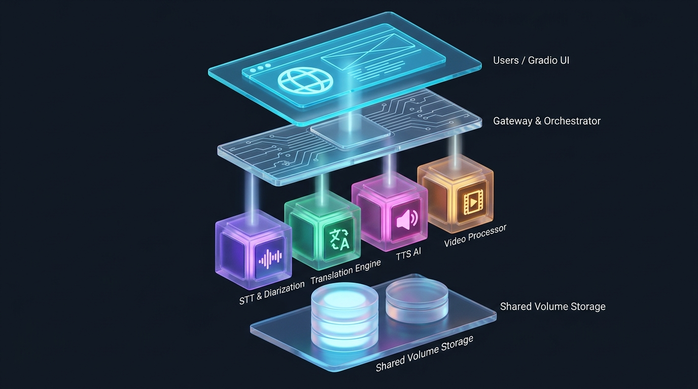

# 🎬 OmniDub Studio

Hệ **microservices AI chạy hoàn toàn cục bộ (local + Docker)** cho quy trình:

**Tải video (YouTube / Bilibili / HH3D) ➔ Tách tiếng ➔ STT (Whisper) ➔ Dịch Trung/Anh → Việt ➔ Phân đoạn người nói + nhận diện giới tính ➔ Lồng tiếng thuyết minh đa nhân vật (TTS) ➔ Gắn Vietsub ➔ Vẽ lại video hoạt hình 3D thành hoạt hình 2D ➔ Cắt ghép, xuất file.**

Không dùng API trả phí, không đẩy dữ liệu lên cloud. Muốn dùng mà **không cần mở cmd, không cần gõ lệnh** → xem [🖥️ App Electron](#-electron--chạy-không-cần-gõ-lệnh).

---

## ✨ Có gì

| | Tính năng |
|---|---|
| 🎙️ | **Lồng tiếng & Vietsub**: Whisper → dịch → TTS 8 giọng Việt, tự chia giọng Nam/Nữ theo từng nhân vật |
| 🎨 | **Vẽ lại 3D ➔ 2D** (Remake): 4 phong cách, tẩy chữ burn-in, chống Content ID, giữ/bỏ tiếng gốc |
| 📖 | **Truyện ➔ storyboard 3D**: tách lời thoại + sinh prompt cho Wan2.1 / FLUX / LTX-Video |
| ✂️ | **Cắt & chỉnh video**: trim theo mm:ss, hardsub, mix âm, anti-copyright |
| 🖥️ | **App Electron** đóng gói 1 file `.exe`: bấm nút là hệ thống tự lên |

---

## 🏗️ Kiến trúc



```
       +-------------------------------------------------------------+
       |                  🌐 USERS / CLIENT BROWSERS                 |
       |                (http://localhost:7860 - Gradio)             |
       +------------------------------+------------------------------+
                                      |
                                      v
  ============================= [ DOCKER NETWORK ] =============================

     +-------------------------------------------------------------------+
     |                     📦 SERVICE 1: GATEWAY & UI                    |
     |                  [translate-gateway] (Port: 7860/8088)            |
     |  - Giao diện Web Studio (Gradio Blocks, 4 tab)                    |
     |  - Tải & Chuẩn hoá URL YouTube / Bilibili / HH3D (yt-dlp + crawler)|
     |  - Preflight đầu vào, nghe thử giọng, điều phối toàn pipeline     |
     +-------+--------------------+--------------------+-----------------+
             |                    |                    |                 |
             v                    v                    v                 v
     +---------------+    +---------------+    +---------------+    +---------------+
     | 📦 SERVICE 2  |    | 📦 SERVICE 3  |    | 📦 SERVICE 4  |    | 📦 SERVICE 5  |
     |  STT & VOICE  |    |  TRANSLATION  |    | MULTI-TTS AI  |    | VIDEO & 2D    |
     | [translate-   |    | [translate-   |    | [translate-   |    | [translate-   |
     |  stt] :8001   |    |  translation] |    |  tts] :8003   |    |  video] :8004 |
     |---------------|    | (GPU) :8002   |    |---------------|    |---------------|
     | • Whisper STT |    | • Helsinki-   |    | • 8 Giọng Nam |    | • FFmpeg Core |
     |   (float16    |    |   NLP Opus-MT |    |   & Nữ Neural |    | • Tẩy chữ     |
     |   medium)     |    | • Dịch Trung  |    | • Auto Gender |    |   burn-in     |
     | • Speaker     |    |   ➔ Việt       |    |   Voice Sync  |    | • AnimeGANv2  |
     |   Diarization |    | • Dịch Anh    |    | • Google TTS  |    | • Cel-flat    |
     | • F0 Pitch    |    |   ➔ Việt       |    |   Fallback    |    | • Draw-on-twos|
     |   Gender Clf  |    | • Giữ nguyên  |    | • Local MMS   |    | • Burn sub srt|
     |   (Nam / Nữ)  |    |   timestamps  |    |   VITS Model  |    | • Mix/Trim/   |
     | (GPU)         |    |               |    |               |    |   2D restyle  |
     +-------+-------+    +-------+-------+    +-------+-------+    +-------+-------+
             |                    |                    |                    |
             +--------------------+--------------------+--------------------+
                                      |
                                      v
     +-------------------------------------------------------------------+
     |              💾 DOCKER SHARED VOLUME (/shared_data)               |
     |  mount thẳng từ  D:\translate\shared_data                          |
     |  - audio/     : Video gốc, video đã cắt, audio trích xuất          |
     |  - data/      : srt vietsub, json hội thoại & dịch thuật           |
     |  - segments/  : Từng câu thoại TTS đã lồng tiếng độc lập           |
     |  - preview/   : File ảnh/âm thanh kiểm tra, nghe thử               |
     |  - output/    : Video Vietsub / Thuyết minh / 2D / Cắt ghép        |
     +-------------------------------------------------------------------+
```

Cả 5 container đều **`deploy.resources.reservations.devices: nvidia` → cần GPU NVIDIA + CUDA**.

### ⚠️ Sự thật kiến trúc: Docker KHÔNG chạy bằng Docker Desktop

Đây là chỗ dễ hiểu nhầm nhất, và chính nó từng làm app Electron báo sai
`docker=null, 5/5 service absent` trong khi stack **vẫn đang chạy thật**.

* `docker version` phía Windows chết với:
  `failed to connect to the docker API at npipe:////./pipe/dockerDesktopLinuxEngine`
  → **Docker Desktop không chạy** trên máy này.
* `dockerd` thật sự nằm **bên trong distro Ubuntu (WSL2)**. 5 container sống ở đó.
* Cổng Windows (7860, 8001–8004) vẫn truy cập được nhờ **port forwarding mặc định của WSL2**.

Lệnh chuẩn (đúng như `start_wsl.bat` đang làm):

```powershell
wsl -u root -d Ubuntu -e bash -c "cd /mnt/d/translate && docker compose up -d"
```

Mọi thao tác Docker trong project này đều phải đi qua WSL. Đường dẫn Windows
`D:\translate` tương ứng `/mnt/d/translate` trong WSL.

---

## 🖥️ Electron — chạy không cần gõ lệnh

`electron/` là bộ điều khiển đồ hoạ cho toàn stack: **mở app ➔ bấm 1 nút ➔ có video**,
không cần cmd, không cần nhớ lệnh nào.

### Cách dùng hàng ngày

1. Mở `electron\dist\OmniDubStudio.exe` (file self-contained, ~71 MB, không cần cài đặt).
2. Bấm **▶ Khởi động hệ thống**. App sẽ:
   * kiểm tra `docker-compose.yml` có thật trong thư mục dự án;
   * bật `dockerd` trong WSL (`systemctl start docker`, thử lại tối đa 60 s);
   * chạy `docker compose up -d`;
   * kiểm tra 5/5 service và **tự mở cửa sổ Studio** (`http://localhost:7860`).
3. Làm việc trong Studio như bình thường. Đóng cửa sổ điều khiển chỉ **thu ra khay** — stack vẫn chạy.
4. Các nút có sẵn: `🎬 Mở Studio` · `🔁 Rebuild video-service` · `🧹 Dọn build cache` · `⏹ Dừng toàn bộ` · `📁 Mở thư mục output` · xem `log` từng service.

### Build từ source (khi kéo code mới)

```powershell
cd D:\translate\electron
npm install
npm run smoke     # ELECTRON_SMOKE=1: tự kiểm tra rồi thoát, in ra "SMOKE status: docker=... up=..."
npm start         # mở app bình thường
npm run dist      # xuất dist\OmniDubStudio.exe (portable) + OmniDubStudio-Setup.exe (NSIS)
```

Kết quả smoke test thực tế trên máy dev:

```
SMOKE status: docker=29.1.3 up=5 services=translate-gateway:running,translate-stt:running,
translate-translation:running,translate-tts:running,translate-video:running   (exit=0)
```

### Thiết kế & ràng buộc bảo mật

* `contextIsolation: true`, `nodeIntegration: false`; renderer chỉ gọi qua `preload.js` (contextBridge `window.api`), không đụng `child_process`.
* Tên service khi xin log **bắt buộc khớp whitelist** `SERVICES` — không bao giờ ghép chuỗi tự do vào shell (đường cong quen của command injection).
* tham số user không nối vào shell; đường dẫn dự án lưu `settings.json` trong `%APPDATA%\OmniDub Studio`, không hardcode.
* App **gọi docker qua WSL**, không có đường gọi `docker` thẳng từ Windows (xem lỗi kiến trúc ở trên).
* Chưa ký số (code signing) nên Windows SmartScreen có thể hỏi lần chạy đầu; chưa có icon riêng nên dùng icon mặc định của Electron.

---

## 🎨 Vẽ lại video hoạt hình 3D ➔ 2D (tab 3)

### Luồng xử lý

1. **Nguồn**: dán URL (Bilibili / YouTube / HH3D) hoặc upload file; cắt theo khoảng `00:22 ➜ 15:35`.
   * URL chỉ tải được khi tích **⚖️ Tôi xác nhận có quyền sử dụng nội dung ở URL trên** — không tích, gateway báo `ValueError: Tải video từ URL chỉ được phép khi bạn xác nhận có quyền sử dụng nội dung đó` (đây là tính năng, không phải lỗi).
   * HH3D cần crawler riêng (`hh3d_crawler.py`) vì site nhúng stream vào file PNG giả.
2. **Preflight** (`/probe`): `ffprobe` + `volumedetect` — chặn file hỏng/cắt ngắn trước khi đốt 40 phút render.
3. **Tẩy chữ burn-in** — **TRƯỚC** khi vẽ 2D (xóa sau GAN sẽ để lại quầng).
4. **Vẽ lại 2D** theo phong cách đã chọn.
5. **`_finalize_mux`**: chống Content ID + ghép tiếng.

### 4 phong cách

| Phong cách | Engine | Ghi chú |
|---|---|---|
| `Cel Flat 2D` | mean-shift + bảng màu khoá cả video + `drawContours` | Phá kết cấu 3D, nét vẽ lại đều tay; mặc định của dropdown |
| `Anime 2D Cel-Shading` | **AnimeGANv2 `face_paint_512_v1`** + `_cel_fit_gan` (áp bảng màu chung) + `_cel_over` (lớp nét mực) | **Đang cho kết quả tốt nhất**, ~138 ms/frame |
| `AnimeGAN AI 2D (Shinkai/Ghibli)` | AnimeGANv2 **`paprika`** | Màu ám vàng ấm, hợp khung cảnh |
| `2D Hoạt Hình Comic` | nét viền đậm | |

### Tẩy logo burn-in: phát hiện theo thời gian, không cần biết vị trí

Bài học lớn nhất của module này: phiên bản đầu lưu **hộp toạ độ cố định** (`_TEXT_ROIS`) do tay đo
trên một tập khác → tất cả hộp nằm bên phải khung hình. Tập `tap-106` lại đặt `bit.ly/YanHH3D` ở
**góc trên TRÁI** (`x 5.4–26.3%`, `y 11.9–19.5%`) nên logo sống sót nguyên vẹn.

Cách hiện tại **không cần biết logo nằm đâu**:

* Lấy ~48 khung trải đều, tính **tophat** = `gray − opening(gray, 15×15)` cho từng khung.
* Logo là PNG **bán trong suốt** đè lên nền động ⇒ `std(gray)` theo thời gian = 42–62, tức
  "chỗ này ít đổi" là tiêu chí **vô dụng**. Tín hiệu ổn định là **`p75(tophat) > 26`**, điều kiện màu:
  `(p75 > 60 độ mặn) hoặc (p75 > 45)`.
  Đo thực nghiệm: `bit.ly` 41.2% · `牧神記` 31.7% · `bilibili` 18.9% · **control (tóc nhân vật) 0.0%**.
  *Không dùng `p25`*: logo chỉ xuất hiện ~40% số khung ⇒ `p25 > 11` cho tỉ lệ lọt = 0.0%.
* **Vùng giữ**: dải trên `y < 0.26` (cả ngang) + hai góc dưới (`x < 0.06` hoặc `x > 0.80` khi `y > 0.78`).
  Bắt buộc loại dải giữa-đáy: thử nghiệm cho ra một vùng giả **428×111 = 15% khung hình** đúng chỗ phụ đề,
  mà phụ đề đã bị xử lý riêng **từng khung** bởi `_subtitle_glyphs`.
* **Cổng `live` từng khung**: `extra` chỉ được AND với `(tophat>12) | (sat>80) | (gray>145)` (giãn 5×5).
  Không có cổng này, những khung *không có logo* bị TELEA nhoè cả góc.
* Kích hoạt bằng `remove_watermark`. Log thực tế khi render: `[neural] overlay bat dong: 21684 diem = 4.73% khung, 6s` — trùng khớp 100% với đo offline.

### Hình học & tốc độ

* Render ở **896×512**; `_finalize_mux` áp `crop=iw*0.96:ih*0.96` ⇒ file xuất **860×492**.
  (Toạ độ đo trên 896×512, đừng nhân sang 860×492.)
* `fps_div=2` = **draw on twos** 12.5 fps: đúng chất anime và **nhanh gấp đôi**.
* `palette_k` = số màu bảng màu chung (8–28; dùng 16–20) — khoá màu cả video để màu **không flicker** giữa các frame.
* `anti_copyright`: zoom/cắt 96%, `setpts=PTS/1.03` (nhanh 3%); pitch `asetrate=44100*1.04` + `atempo=1.03/1.04` **chỉ khi còn tiếng gốc**.

### Âm thanh của video 2D

* Mặc định **TẮT** `Giữ tiếng gốc` ⇒ bỏ tiếng Trung + nhạc nền. Nếu chưa chạy Tab 1 thì **video 2D im lặng** (không phải lỗi).
* Bật `Giữ tiếng gốc` ⇒ tiếng kênh gốc đi qua, có trượt pitch để khỏi nhận dạng.
* Nếu đã lồng tiếng ở Tab 1, `find_dub_audio()` chỉ nhận `output/dubbed_audio.wav` khi
  `|dub − video| ≤ max(2.5 s, 5% video)` — lệch quá mức này coi như chưa có lồng tiếng, thà im lặng còn hơn lệch môi.
* Muốn video **chạy nhanh 2×** từ file đã có (không render lại): `setpts=PTS/2` + `atempo=2.0` → xem `tools/speed2x.sh` (907 s ➜ 453.9 s, làm xong trong 51 s).

---

## 🧩 Chi tiết từng microservice

### 1. `gateway-service` — Cổng điều phối & Gradio UI
* **Container:** `translate-gateway` · **Cổng:** `7860` (UI) | `8088` (API)
* 4 tab: 🎙️ Lồng Tiếng & Vietsub · 🎨 Chuyển Thể Truyện ➔ Hoạt Hình 3D · 🖌️ Vẽ Lại 3D ➔ 2D · ✂️ Chỉnh Sửa & Cắt Video
* Ưu tiên **upload file** (mặc định, không cần xác nhận). Tải từ URL là tuỳ chọn và **chỉ chạy khi tích ô xác nhận quyền** (tự làm sạch định dạng `/zh-Hans/` và mã `BV...`).
* **Preflight** trước khi chạy Whisper/Dịch/TTS; workspace chỉ bị xoá sau khi đầu vào đã hợp lệ.
* **Voice Audition**: nghe thử giọng ngay, không cần dịch cả video.

### 2. `stt-service` — Nhận dạng giọng nói & phân tích tiếng nói
* **Container:** `translate-stt` · **Cổng:** `8001` · **GPU**
* `faster-whisper medium` **float16** trên GPU — câu thoại kèm timestamp chính xác.
* **Speaker Diarization**: MFCC + Spectral Centroid + Agglomerative Clustering → `SPEAKER_00`, `SPEAKER_01`.
* **Gender Classification** bằng `librosa.pyin` đo \\(F_0\\): \\(F_0 \ge 165\,\text{Hz}\\) ➔ **Nữ**, ngược lại ➔ **Nam**.

### 3. `translation-service` — Dịch thuật
* **Container:** `translate-translation` · **Cổng:** `8002` · **GPU**
* `Helsinki-NLP/opus-mt-zh-vi` (Trung ➔ Việt), `opus-mt-en-vi` (Anh ➔ Việt).
* Sinh `.srt` chuẩn, **giữ nguyên timestamp** để lồng tiếng khớp môi.

### 4. `tts-service` — Lồng tiếng đa giọng, đa nhân vật
* **Container:** `translate-tts` · **Cổng:** `8003` · **GPU**
* 8 giọng Việt: *Nữ* — Hoài My (truyền cảm), Trẻ trung tươi sáng, Dịu dàng trầm tĩnh, Chị Google; *Nam* — Nam Minh (ấm áp), Trầm ấm phóng sự, Năng động tin tức; *MMS AI* — VITS chạy cục bộ trên GPU.
* **Multi-Speaker Auto-Dubbing**: luân phiên Nam/Nữ theo hội thoại đã diarize.
* **Anti-Voice Switching**: thử lại 4 lần khi mạng chập chờn, fallback Google TTS **cùng giới tính** để giọng không bị đổi giữa video.

### 5. `video-service` — FFmpeg, tẩy chữ, vẽ 2D, mix & cắt
* **Container:** `translate-video` · **Cổng:** `8004` · **GPU**
* Endpoints: `POST /probe` · `POST /extract-audio` · `POST /merge` · `POST /trim` · `POST /restyle-2d` · `GET /health`
* Hardsub bằng filter `subtitles`; Audio Ducking hạ nền khi có thuyết minh; Trim xuất clip ngắn đăng Reels/TikTok/Shorts.

---

## 🚀 Vận hành

### Cách 1 — App Electron (khuyên dùng)
`electron\dist\OmniDubStudio.exe` ➔ bấm **▶ Khởi động hệ thống**. Xem [🖥️ Electron](#-electron--chạy-không-cần-gõ-lệnh).

### Cách 2 — Script Windows
`start_wsl.bat` (dựng stack trong WSL) · `stop_wsl.bat` · `view_logs.bat`.
`start_services.bat` / `stop_services.bat` chỉ đúng khi máy bạn **có** Docker Desktop chạy thẳng trên Windows.

### Cách 3 — Dòng lệnh (PowerShell)
```powershell
wsl -u root -d Ubuntu -e bash -c "cd /mnt/d/translate && docker compose up -d"
start http://localhost:7860
wsl -u root -d Ubuntu -e bash -c "cd /mnt/d/translate && docker compose logs -f video"
wsl -u root -d Ubuntu -e bash -c "cd /mnt/d/translate && docker compose down"
```

### Rebuild khi sửa code
```powershell
# an toàn: chỉ dừng video-service, 4 service còn lại giữ nguyên uptime
wsl -u root -d Ubuntu -e bash -c "cd /mnt/d/translate && docker compose build video-service && docker compose up -d video-service"
```
> **Quy tắc làm việc:** `gateway/stt/translation/tts` đang phục vụ các phiên lồng tiếng dài
> ⇒ **không** restart nếu chưa được yêu cầu. Chỉ `video-service` được rebuild/recreate.

### Yêu cầu môi trường
* Windows + **WSL2 distro Ubuntu** có `docker` + `docker compose` + NVIDIA Container Toolkit.
* GPU NVIDIA (máy dev: RTX 5060 Ti), driver CUDA; torch trong `video-service` là bản **cu128**.
* Đĩa: image GPU ~12 GB/chiếc, `models/` ~13 GB (**không** track bằng git — xem `.gitignore`).
* Internet cho **lần chạy đầu**: `torch.hub` tải trọng số AnimeGANv2 (`face_paint_512_v1`, `paprika`) vào cache trong container; `faster-whisper`/Opus-MT/MMS tải từ Hugging Face.
* Node.js 18+ chỉ cần khi build lại app Electron.

---

## 🧾 Hiệu năng đo thực tế (RTX 5060 Ti)

| Việc | Số đo |
|---|---|
| Vẽ 2D cả tập ~15 phút (11 688 frame @ 896×512, cel-shading) | **1 614.3 s ≈ 27 phút**, **138 ms/frame** |
| Phát hiện overlay logo (48 khung mẫu) | 6 s, 21 684 điểm = **4.73%** khung hình |
| Tẩy chữ + vẽ GAN theo thời gian thực | pipeline gộp trong một lượt render |
| Xuất nhanh 2× từ file đã render | **51 s** (907.7 s ➜ 453.9 s) |
| `docker builder prune -f` | lấy lại **53.79 GB** |
| Dọn video/ảnh test theo danh sách tường minh | lấy lại **2.05 GB** |
| App portable | `OmniDubStudio.exe` **70.9 MB** |

---

## 🧹 Vệ sinh đĩa

Build cache mới là thứ ngốn đĩa, không phải file test: `docker system df` từng báo
**Images 91.04 GB (85.93 GB reclaimable) + Build Cache 53.79 GB** trong khi toàn bộ media test chỉ ~2.7 GB.

```powershell
# AN TOÀN với container đang chạy (đã kiểm chứng: uptime không đổi)
wsl -u root -d Ubuntu -e bash -c "docker builder prune -f"
wsl -u root -d Ubuntu -e bash -c "docker image prune -f"   # chỉ xoá image <none> không tag
wsl -u root -d Ubuntu -e bash -c "docker system df"
```

Xoá media test: **không** dùng wildcard thư mục. Duyệt danh sách đường dẫn tường minh —
mẫu có sẵn ở `tools/cleanup_list.txt`, chạy bằng vòng lặp PowerShell đọc tệp đó.

---

## 🛠️ Script hỗ trợ (`tools/`)

| Script | Dùng để |
|---|---|
| `render_full.sh` | POST payload đầy đủ lên `/restyle-2d` cho cả tập (kèm kiểm tra cú pháp `main.py` và build `video-service`) |
| `speed2x.sh` | `setpts=PTS/2` + `atempo=2.0` ➜ file 2× không cần render lại |
| `mux_audio.sh` | ghép tiếng gốc hoặc `dubbed_audio.wav` vào video 2D đã có |
| `verify_final.sh` | trích frame ở 6 mốc thời gian để mắt thường kiểm tra còn chữ hay không |
| `probe_text.sh` / `check_overlay.py` / `diag_overlay.py` | đo tỉ lệ lọt tophat/p75, biện minh ngưỡng |
| `probe_hh3d.py` | kiểm tra crawler HH3D còn lấy được `m3u8` từ trong gateway |
| `dl_models.sh` / `anime_setup_models.sh` | tải trọng số 2D |
| `cleanup_list.txt` | danh sách đường dẫn được phép xoá |

**Mẹo chạy script từ Windows** (PowerShell làm hỏng `\"`, `$biến`, `|` và heredoc bên trong `wsl -c "..."`):

```powershell
wsl -d Ubuntu -u root bash -c "tr -d '\r' < /mnt/d/translate/tools/render_full.sh > /tmp/r.sh; bash /tmp/r.sh"
```

---

## ⚠️ Giới hạn thật (nói thẳng, không tô hồng)

* **Logo giữa khung hình không bị tẩy**: vùng giữ chỉ gồm dải trên (`y<0.26`) và hai góc dưới.
  Logo lọt vào dải `y 26–78%` **cố ý** không bị bắt, vì vùng đó chứa mặt/nhân vật.
* Đây là vẽ lại **màu và nét** từng frame, **không phải** vẽ lại **hình học khuôn mặt**: mắt/mũi vẫn là mặt 3D.
  Muốn anime thực sự ở phần mặt cần diffusion, chi phí thực đo 6–14 giờ/tập.
* `models/` (~13 GB) và `electron/node_modules`, `electron/dist` **không** nằm trong git — clone về phải tự tải trọng số.
* Crawler HH3D phụ thuộc cấu trúc site (`fake PNG ➜ m3u8`) ⇒ dễ hỏng khi site đổi, và CDN hay đổi IP.
* Anti-copyright **làm giảm** khả năng bị Content ID chấm khớp, **không bảo đảm** vượt qua; và quan trọng hơn:
  quyền phân phối nội dung là trách nhiệm người dùng, vì vậy gateway **bắt buộc** tích ô xác nhận quyền trước khi tải URL.
* App chưa ký số + chưa có icon riêng (SmartScreen có thể hỏi lần đầu).
* Video 2D mặc định **im lặng** nếu chưa lồng tiếng ở Tab 1 và không bật "Giữ tiếng gốc".

---

## 📁 Cấu trúc thư mục

```
D:\translate
├─ services/{gateway,stt,translation,tts,video}/   # 5 microservice (Dockerfile + main.py)
├─ electron/                  # app desktop: main.js, preload.js, index.html, package.json, dist/
├─ shared_data/               # volume mount vào /shared_data (audio, data, segments, preview, output)
├─ tools/                     # script vận hành & chẩn đoán
├─ models/                    # trọng số 2D (~13 GB, KHÔNG commit)
├─ docs/images/               # sơ đồ kiến trúc
├─ docker-compose.yml         # 5 service + GPU reservation
├─ start_wsl.bat / stop_wsl.bat / view_logs.bat
└─ hh3d_crawler.py            # crawler cho site hoạt hình 3D
```

## 📄 License

MIT. Chỉ dùng cho nội dung bạn có quyền sử dụng.
